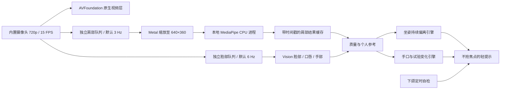

# Kukusit 0.5：架构审查与监测能力

本轮目标是把提醒做成可以自行调优的软件，缩短视频等待时间，并增加可观察的手口、口唇与眼周习惯提示。只使用 MacBook 内置摄像头，不录音，不增加外接设备。

## 八项需求的处理

| 需求 | 本轮处理 | 实际边界 |
|---|---|---|
| 提醒太慢、参数开放 | 默认 5 秒 / 3°；时间、角度、恢复、冷却、丢点容忍和观看范围均可调整，立即生效；预设和参数文件导入导出 | 调整会重新观察，不能把不可靠帧变成可靠判定 |
| 敏感度与个人校准 | 头部恢复默认 1.5°、持续 2 秒；口唇和眼周与个人自然参考比较 | 不把天然左右差异当作应当纠正的病态，也不推断大小脸病因 |
| 视频首帧慢 | 原生 AVFoundation 视频层独立显示；识别异步进行，肩部启动不再阻塞视频或头部分析 | 系统授权、摄像头本身启动及缓存状态仍影响时间；肩部模型准备时间单独存在 |
| CPU/GPU/神经引擎 | 原生 Vision 可选自动、CPU、GPU、Neural Engine 优先；支持能力按系统查询；肩部独立低优先级队列、3 Hz 默认、640×360 输入；无 CGImage 视频复制 | MediaPipe 肩部运行时仍为 CPU，不能声称整个程序已在 Neural Engine 上运行 |
| 手指与牙唇习惯 | 持续手部关键点靠近口唇会提示；口唇压缩变化为可关闭试验；下颌放松定时自检 | 不确认咬手指、摸牙、磨牙、紧咬、具体哪颗牙接触上下唇 |
| 更细的脸部观察 | 眼线对齐、尺度归一后，计算口唇高度、开口、嘴角横移、嘴角倾斜及双眼开合差，保存个人参考 | 正面、清晰、近静态时试用；不输出医学对称分数或诊断 |
| 应用程序与签名 | 标准 macOS 应用与 Dock；安装脚本注册到 /Applications，DMG 拖拽安装；本地开发证书和私钥在登录钥匙串 | 自签名不是 Apple Developer ID 公证；首次密钥使用可能需要系统授权 |
| 全盘审查 | 修复启动耦合、阈值双重限制、设置兼容、模型切换导致头部参考失效、可选识别错误停机、子进程环境继承等问题 | 真实动作的误报/漏报率、M5 实机及长期使用测试仍需验证 |

## 为什么左右脸差异不能直接归因于坐姿

面部轻微不对称在一般人群中常见；显著不对称的原因与评估涉及问诊、口内外检查及必要的影像检查，不能由一个摄像头姿态值判断。见 [Facial asymmetry: a current review（PubMed）](https://pubmed.ncbi.nlm.nih.gov/26691977/)。本软件的目标是提高对可见动作的觉察，不保证改善面部结构。

磨牙和紧咬的评估涉及症状、牙齿及颌面检查；闭唇不能证明牙齿正在紧咬。白天的定时自我提醒是可行的觉察方式，但应明确显示成“自检”，不伪装成检测。见 [NIH/NIDCR：Bruxism](https://www.nidcr.nih.gov/health-info/bruxism)。如果差异近期出现、加重，或伴颌面疼痛、张口受限，应由牙科评估，而不是继续靠调姿态阈值判断。相关症状与评估见 [NIH/NIDCR：TMD](https://www.nidcr.nih.gov/health-info/tmd)。

## 先区分表现，再选择观察方法

以下是算法观察假设，不是疾病与病因的对应诊断。

| 可见表现或关注点 | 可能同样产生这种画面的动作/因素 | 匹配方法 | 是否自动提醒 |
|---|---|---|---|
| 持续偏头、倾斜 | 观看位置、身体同向倾斜、调整姿态 | 脸部 roll 与个人参考比较；肩线用于区分一般坐姿提示 | 是，稳定且持续超阈值 |
| 手持续靠近嘴唇 | 咬指、摸牙、托腮、吃东西、扶物品，或只是手悬在嘴前 | 手指尖及远端关节点到唇轮廓的二维距离，按嘴宽归一 | 是，但只称“手靠近嘴唇” |
| 口唇变薄、持续收紧 | 抿嘴、唇部表情、疑似咬唇；也可能是视角或遮挡 | 闭口状态下的外唇高度/宽度与个人参考比较 | 可关闭的试验提示 |
| 嘴角偏移或倾斜 | 说话、表情、单侧口唇用力、拍摄误差 | 眼线对齐后，嘴角相对鼻部的横移与倾斜变化 | 可关闭的试验提示 |
| 双眼开合持续不一致 | 单侧眯眼、单侧眨眼、遮挡或定位误差 | 与个人双眼开合差比较，排除短暂变化 | 可关闭的试验提示 |
| 长期左右脸、腮帮大小差异 | 原有结构/软组织差异与投影视角等，需要专业评估 | 不使用原始左右大小作为坏习惯判据 | 否 |
| 牙齿紧绷、无声紧咬 | 往往缺少明确的外部可见信号 | 无法从闭唇或下颌静止确认咬合力量 | 定时自检，不是检测 |
| 磨牙、犬牙摩擦下唇、上下牙咬唇 | 牙齿和接触位置可能不可见，动作相似 | 当前缺少经过验证的动作模型及可见信息 | 不作自动分类承诺 |

试验模式默认关闭。说话时的开口会抑制口唇压缩与嘴角变化提示；大幅观看偏转、多个目标、丢失口唇观察时保持安静。吃饭、喝水等活动仍可能触发手口接近，用户可以关闭这一功能。真实精度尚未用带标注的人体动作数据集量化。

## 新的管线

每条分析路径只允许一个任务在处理，繁忙时丢掉新分析任务，不堆积旧帧。肩部结果超过 0.75 秒便不使用。工作进程启动、超时及重试只影响肩部；头部继续使用原生观察。视频不经过 Python，也不依赖识别结果。

原先每次肩部调用传输约 3.7 MB 的 720p BGRA。现在每帧约 0.92 MB，并从默认 6 Hz 降到 3 Hz，理论管道字节量约降为原来的八分之一；这是数据量推导，不等于 CPU 或功耗实测降幅。

[Apple 视频预览层](https://developer.apple.com/documentation/avfoundation/avcapturevideopreviewlayer)负责原生呈现；[Vision 手部识别](https://developer.apple.com/documentation/vision/vndetecthumanhandposerequest)提供手部关键点。设备能力同时用本机 SDK 和实际请求探测，不以芯片宣传规格推断实际调用设备。MediaPipe 的 VIDEO 跟踪模式继续使用，见 [官方说明](https://developers.google.com/edge/mediapipe/solutions/vision/pose_landmarker/python)。

## 审查发现与修复

1. UI 最低 20 秒，后端还再次限制最低 20 秒：统一参数模型和验证范围，默认 5 秒。
2. 增加 Codable 字段会让旧设置解码失败：采用逐字段兼容加载，保留窗口、暂停启动和显示器偏好。
3. 预览等待同步工作进程：视频层、脸部队列、肩部队列分别运行。
4. 可选手部/关键点请求失败会影响全部脸部观察：可选失败不停止摄像头，也不把旧角度作为新结果。
5. 工作进程失败后永久停用：增加独立重试与明确原因，头部不受影响。
6. 肩部模型被混进头部参考身份：头部只校验摄像头、分辨率、方向、脸部算法；肩部仍校验完整模型身份。
7. 肩部模型选择、镜像等偏好不完整持久化：保存到设置。
8. 工作进程继承整个环境：仅提供必要路径、语言、临时目录和线程限制。
9. 自签名要求只校验 bundle identifier：本地开发签名增加证书绑定；私钥只保存在钥匙串，临时导入文件清理。
10. 更新 Python 文件可能仍打包旧冻结运行时：加入来源指纹验证，变更后重建运行时。
11. UIElement 应用不在 Dock、没有安装流程：改为普通应用，增加 Applications 安装与 Launch Services 注册。
12. 口部提醒与坐姿恢复可能共用错误状态：提示来源分离，坐姿恢复不能把手口提示标成“已恢复”。

## 尚未实现或不能据此宣称

- 精确分类每一种牙齿接触、测量咬合力量、诊断磨牙或判断面部不对称病因。
- 经真实用户动作标注验证的习惯分类模型、公开的误报/漏报率。
- 3D 颌骨/牙列测量；单摄像头的二维关键点不具有这种能力。
- MediaPipe 肩部模型的 Core ML 转换与 ANE 推理。需验证转换、坐标和肩部识别质量后替换，不能只更改设备名称。
- 同一人的生物识别验证。当前使用唯一目标，不建立脸部身份数据库；换人需暂停或重新校准。
- Apple Developer ID 公证、自动更新、开机登录项、Intel 发行包、M5 实机验证。
- 极低光、遮挡、强侧转和长期热状态的性能/质量数据。

旧版桥接检查在本次 M2 / macOS 27 环境中曾用时 13.77 秒（进程准备加两帧空白推理，不使用摄像头）。这能说明同步准备不适合放在视频路径中，不能作为摄像头首帧、真实动作准确率或 M5 性能数据。新版本将首帧可用时间与识别统计直接显示在性能页，测试数值应注明授权状态与冷热启动条件。

## 本轮本机性能取样

2026-10-11，M2 / macOS 27，已有摄像头授权，后台采集 25 秒、关闭提醒、不显示视频窗口：首个采集帧可用约 **1.73 秒**，首个分析结果约 **1.81 秒**，脸部约 **6.02 Hz**，脸部管线 p95 约 **14.7 ms**，应用平均 CPU 约 **23.1%**（按单核 100%，不含独立肩部进程）。这是本次取样，未保存图像或逐帧关键点。结果不等同于首个屏幕呈现时间、全程序功耗或 M5 表现；已有框架缓存与后台工作负载也会影响数值。

原生设备偏好的合成检查分别执行了自动、CPU、GPU、Neural Engine 请求，并验证缩小后的 BGRA 方向和 640×360 大小。空白图像及不同模型准备顺序不能用于设备速度排名，也不能衡量真人动作准确率。
