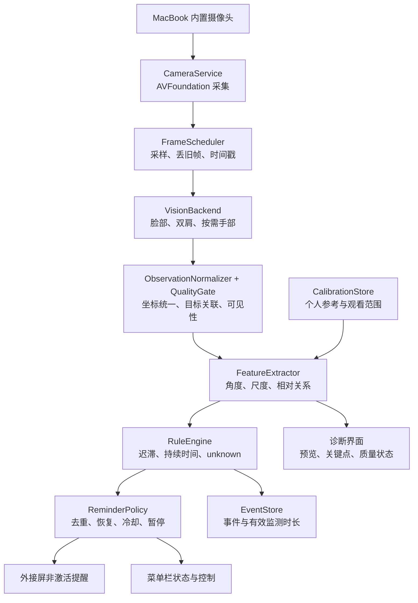

# MacBook 内置摄像头坐姿监测：架构 v0.1

日期：2026-10-09。状态：初版架构建议；本机验证结果见 `feasibility-v0.1.md`。后续已实现诊断 MVP，并根据实拍将肩部后端调整为本地 MediaPipe；最新实现与结果见 [MVP v0.2](mvp-v0.2.md)。本文保留最初规划作为决策背景。

## 1. 结论与约束

采用一个本地运行的 macOS 菜单栏应用：**SwiftUI + AppKit + AVFoundation + Apple Vision + 独立的姿态规则引擎**。摄像头固定使用 MacBook 内置摄像头，提醒显示在用户选定的外接屏。

笔记本敞开、放在正前方，外接显示器位于其上方。这使摄像头与主要视线方向不重合。第一版必须围绕这个安装条件建立个人参考，而不能以“眼睛直视镜头、头部角度为零”为正常姿态。

首版先验证持续歪头和肩线偏移；手口接近在基础监测稳定后启用；探颈作为实验指标。原讨论中的手机端、USB 通信、视频推流和跨设备事件协议全部退出当前架构。

单个正面 RGB 摄像头能观察外观变化，但不能唯一恢复真实的颈部、脊柱姿态，也不能确认牙齿是否咬紧。软件输出是提醒所需的可见信号和置信度。

## 2. 功能范围

下表是针对当前机位的工程判断，并非实测准确率。

| 需求 | 可观察信号 | 第一版行为 | 主要限制 |
|---|---|---|---|
| 头歪 | 面部 roll、头部与肩线相对偏移 | P0：持续偏离后提醒 | 仰拍、身体旋转、脸部遮挡 |
| 高低肩 | 左右肩的像素高度差、肩线角度 | P0：提示“肩线持续偏离参考” | 双肩必须可见；不能独立区分整体侧倾与单肩抬高 |
| 侧头 | 面部 yaw 相对个人参考变化 | P1：先记录，仅对持续且大幅偏离的情况提醒 | 扫视外接屏、与旁人交流是正常动作 |
| 低头／仰头 | 面部 pitch 相对已校准观看范围 | P1：默认保守，需通过上下屏负例验证 | 低机位自身有偏差；头部方向不等于眼睛注视方向 |
| 咬手指 | 指尖持续接近嘴部区域 | P1：提示“手持续靠近嘴部” | 不能确认咬合；托腮、喝水、遮挡容易混淆 |
| 头前倾 | 脸部／肩部尺度比例、头肩二维关系 | P2：实验状态，只记录疑似靠近 | 正面单目深度含糊，不输出厘米数或颈椎角度 |
| 咬唇 | 嘴部局部连续外观变化 | 后置；需要个人样本和专门验证 | 说话、吞咽、嘴唇遮挡；现成关键点没有直接的咬唇标签 |
| 咬牙 | 普通视频中通常缺乏可辨别证据 | 不纳入自动检测承诺 | 外观正常时也可能咬牙 |

肩膀看不全时，允许只启用头部检测，不能用模型补全的肩点强行判断高低肩。髋部不可见时，不启用依赖躯干轴线的“整体侧倾／含胸”分类。

## 3. 数据流与模块边界



所有模块在同一个应用进程内。首版无需后台服务器、网络端口、Python 运行时或 LLM。独立可测试的核心逻辑与视觉实现分开，便于以后更换模型。

| 模块 | 职责与输出 |
|---|---|
| `CameraService` | 枚举并锁定内置摄像头；权限、采集配置、停止、错误恢复；输出带时间戳的 `CVPixelBuffer` |
| `FrameScheduler` | 单个推理任务执行中仅保留最新待处理帧；决定本次运行哪些模型；不积压视频 |
| `VisionBackend` | 将 Apple Vision 观察结果适配为统一结构；只输出事实与可用性，不决定好坏 |
| `ObservationNormalizer` | 统一方向、镜像、ROI 和像素坐标；关联同一个人的脸、身体与手 |
| `QualityGate` | 每条规则检查所需点、置信度、点是否出界、观察是否过时；输出可判定／不可判定 |
| `CalibrationService` | 获取稳定参考、观看范围、波动范围；拒绝低质量校准；提示重新校准 |
| `FeatureExtractor` | 输出角度、尺度变化与归一化距离，附数据来源、有效性和时间戳 |
| `RuleEngine` | 用个人参考、持续时间和迟滞生成事件；不操作窗口、通知或数据库 |
| `ReminderPolicy` | 合并同一原因的提醒，限制频率，处理暂停和误报反馈 |
| `DisplayRouter` | 管理目标显示器、拔插和坐标变化；定位非激活 `NSPanel` |
| `EventStore` | 保存校准版本、事件、有效观察时长与人工反馈；支持删除 |
| `Diagnostics` | 展示关键点、可判定原因、推理耗时、采样率、丢帧计数；服务调试与验证 |

采集管理放在串行队列；视觉请求放在独立串行执行器；规则引擎只处理轻量数值；UI 在主线程。跨任务传递的像素缓冲区必须有明确生命周期，处理结束即释放，不通过无界 `AsyncStream` 保存积压帧。预览只有在校准／诊断窗口打开时显示。

建议以后工程目录为 `App/`、`Capture/`、`Perception/`、`Core/`、`Feedback/`、`Persistence/` 和 `Diagnostics/`，其中 `Core/` 不依赖摄像头和界面。

## 4. 视觉路线选择

| 路线 | 优点 | 代价 | 当前定位 |
|---|---|---|---|
| Apple Vision + Swift | 原生权限、摄像头、窗口和发布路径；不增加外部模型运行时 | 低机位上半身效果需实测；关键点密度与能力不同于 MediaPipe | 首选 |
| MediaPipe Tasks + Python | 适合算法对照、人体／人脸／手部实验 | 分发 Python 和模型包；原生交互需整合；当前 Python／arm64 包仍需安装验证 | Vision 未通过实拍门槛时的对照原型 |
| MediaPipe + Web/Tauri | 前端原型灵活，Web 任务接口明确 | 摄像头权限、WASM 推理、窗口和生命周期还需工程整合 | 当前不引入 |

原生实现建议最低目标 macOS 14，使用稳定的 `VN*` 请求体系，以匹配探针已核实的接口。部署目标不意味着已经在 macOS 14 真机测试过。

- 头部：`VNDetectFaceRectanglesRequest` 提供可选的 roll／yaw／pitch；需要嘴部或眼部几何时，再执行 `VNDetectFaceLandmarksRequest`。角度为弧度，字段可能为 `nil`；缺失值不能当作零。[Apple 面部 pitch 文档](https://developer.apple.com/documentation/vision/vnfaceobservation/pitch)
- 肩部：`VNDetectHumanBodyPoseRequest` 读取左右肩、颈、眼、鼻等可见点。只使用当前画面中质量达标的点。Apple 指出关键区域的覆盖会影响效果，坐标为左下原点的归一化坐标。[Apple 二维姿态文档](https://developer.apple.com/documentation/vision/detecting-human-body-poses-in-images)
- 手部：`VNDetectHumanHandPoseRequest`；不要求全天高频执行。开启手口提醒后，低频扫描兜底，手腕靠近脸时提高采样率。必须保留低频扫描，因为手腕可能未被身体模型识别。
- 不把 `VNDetectHumanBodyPose3DRequest` 作为首版前提：它输出完整 17 点或无结果，无深度数据也能运行，但深度有助于精度。对于当前上半身裁切机位，是否稳定输出尚不清楚。存在 3D API 不等于具有真实深度测量能力。[Apple 三维姿态文档](https://developer.apple.com/documentation/vision/identifying-3d-human-body-poses-in-images)

MediaPipe 官方当前列出 Android、Web、Python、iOS 等 Tasks 平台；不能据此把 iOS Swift 集成当作 macOS Swift 的直接替换。Python 官方列出 Mac 支持，适合作为回退对照，但本次未安装或运行。[平台列表](https://developers.google.com/edge/mediapipe/solutions/guide) · [Python 环境说明](https://developers.google.com/edge/mediapipe/solutions/setup_python)

## 5. 对当前桌面摆放的适配

### 5.1 画面覆盖优先

校准界面先检查完整脸部、两肩与手口区域是否在画面内；双肩应留边距。不要为了让脸部更大而裁掉肩膀。摄像头的左右倾斜、笔记本屏幕开合角度、座椅距离和上方显示器位置都会改变观察结果。

高度影响可用简单模型解释：假设眼睛比镜头高 `h`、水平距离为 `d`、镜头光轴向上倾角为 `β`，脸部相对光轴的方向约为 `atan(h/d) - β`。例如 `h=25cm, d=65cm` 对应水平视线以上约 21°，但实际镜头可能已经向上倾斜。这里的尺寸是假设，不是对当前桌面的测量。

固定偏差可通过参考姿态部分抵消，遮挡、裁切和透视带来的信息缺失不能靠校准恢复。如果现有开合角度无法同时看到脸与双肩，则先交付头部功能，再调整笔记本摆放或评估肩部功能；仍然不要求外接设备。

### 5.2 显式校准观看情境

1. 默认校准“看上方外接屏”：按自己选定的舒适参考坐姿看屏幕中心，采集约 20 秒稳定有效样本。
2. 正常扫视外接屏左右与上下区域，用于记录允许的头部转动范围；这些数据不更新肩部与歪头参考。
3. 如果经常看笔记本，再单独校准下屏情境。偶尔低头打字、取物和转头交流通过持续时间过滤。
4. 保存参考中位数、角度的环绕处理、MAD 波动、相机与采集配置、启用的情境、模型请求版本和时间。有效样本不足或波动过大时拒绝校准。

roll 和肩线规则按情境参考计算。pitch／yaw 优先判断是否仍处于任一已确认的正常观看范围；上下屏切换给约 3 秒缓冲。操作系统知道屏幕在哪里，却不知道人正在看哪里，不能用活动窗口或鼠标所在屏幕当作注视真值。没有充分证据时只记录偏移，避免把“看上屏”判成持续仰头。

不持续自动漂移参考。移动电脑、改变开合角度或座椅高度后，提供一键重新校准。画面位置和尺度长期变化只能提示“参考可能失效”，不能可靠区分机位变化与人改变姿势。

### 5.3 关键几何规则

推理使用未镜像的完整画面，预览可镜像；左右标签使用人体左右。脸部局部点先通过脸框变换到全图，ROI 和模型坐标由适配层明确转换，统一方向之后再计算特征。

设帧尺寸为 `W×H`，肩点归一化差值为 `Δx, Δy`：

```text
shoulderAngle = wrapLine(atan2(Δy * H, Δx * W))
wrapLine 将肩线方向归一到 [-π/2, π/2)，消除端点次序造成的 180°跳变
shoulderDeviation = wrapLine(shoulderAngle - calibratedShoulderAngle)
relativeHeadRoll = wrapAngle((faceRoll - referenceRoll) - shoulderDeviation)
handMouthDistance = 像素空间中指尖到嘴部轮廓的最短距离 / 脸框像素宽度
```

肩线偏移和相对头部 roll 是外观指标；当躯干轴线不可见时，不能据此断言是“肩抬高”还是“身体侧倾”。大幅 yaw 时降低相关判断的可信度。手口距离仅表示二维接近，不证明三维接触或咬手指。

头前倾的实验特征使用脸宽与肩宽的相对变化，以及头肩二维关系。整个人前移会同时放大脸和肩；头部独立前移可能主要放大脸，但脸部旋转、透视和识别抖动仍会造成类似变化。模型的预测 z 值不能作为毫米级深度或医学角度。

## 6. 时间判定与提醒策略

每项功能独立拥有 `unknown → normal → candidate → confirmed → recovering` 状态；提醒策略另存冷却和本次异常是否已提醒。摄像头运行状态与姿态状态分开显示，不能把“正在运行”当作“姿态正常”。

| 初始参数 | 建议值 | 处理原则 |
|---|---|---|
| 视觉采样 | 脸＋身体 6 Hz | 性能不足时降到 3 Hz，保持按时间计算 |
| 手部扫描 | 功能启用时 2 Hz；疑似靠近后约 6 Hz | 允许退出高频；与脸部观察时间相差超过 300ms 则不组合判定 |
| 点质量门槛 | 可从 0.6 开始试验 | 这是模型分数，不代表 60% 准确率；各点与各模型单独调参 |
| 歪头／肩线进入偏移 | 参考约 8°，退出约 5° | 仅作初始工程参数，结合个人波动调节；不是健康标准 |
| 姿态 candidate | 有效异常约 2 秒 | 菜单栏轻量反映状态 |
| 姿态提醒 | 连续有效异常约 12 秒 | 不对短暂动作提醒 |
| 手口接近提醒 | 约 3 秒 | 门槛与距离依个人负例调整 |
| 恢复确认 | 约 3 秒 | 防止阈值附近反复开关 |
| 同类冷却／全局间隔 | 90 秒／至少 30 秒 | 同一持续异常默认只提醒一次，确认恢复后才重新布防 |
| 展示时长 | 约 3 秒 | 不抢键盘焦点；可暂停、关闭或标记误报 |

对每个输入检查单调时间戳；任何无效观察或超过 0.5 秒的采样空档都清空待确认的连续计时，不把缺失时间计入异常。`unknown` 不证明姿态恢复，也不清除已提醒标记；重新看清后仍需有效恢复或重新确认，避免摄像头抖动造成重复提醒。睡眠、锁屏和手动暂停会结束当前监测片段。

当多个人进入画面时，首版暂停判定。之后可以根据中心位置和短期轨迹锁定主目标；禁止把旁人的肩膀与使用者的脸拼接成一个观察结果。恢复需目标重新稳定。

提醒用中性表述，例如“头部持续偏离你的参考，试着调整一下或活动片刻”。不能根据肩线直接宣布“左肩疾病”，或根据手口接近宣布“你在咬手指”。误报反馈先记录原因，不自动重写正常参考。

## 7. 摄像头、显示器与生命周期

`CameraService` 使用内置设备类型发现摄像头，明确选择设备，不能直接依赖系统默认摄像头，以免切到 Continuity Camera。只请求视频权限；原生应用需要 `NSCameraUsageDescription`，按沙盒与签名方式配置摄像头权限。权限拒绝后提供系统设置入口，禁止不停重试权限弹窗。[Apple 权限查询](https://developer.apple.com/documentation/avfoundation/avcapturedevice/authorizationstatus(for:))

从 1280×720 开始；按设备实际支持范围选择 15 或 30 FPS 采集，推理采样独立降到 6 Hz。不能把“每秒分析 6 帧”理解为摄像头功耗也按比例下降。仅当格式确实支持时才调低采集帧率。

使用 `AVCaptureVideoDataOutput.alwaysDiscardsLateVideoFrames = true`，加上自己的有界最新帧槽。此属性只负责采集回调队列上的迟到帧，不能代替异步推理队列的背压。[Apple 丢帧说明](https://developer.apple.com/documentation/avfoundation/avcapturevideodataoutput/alwaysdiscardslatevideoframes)

暂停、锁屏、睡眠、退出时停止会话并释放帧；唤醒后检查权限、设备、画面稳定性和校准状态。会议模式由用户显式开启。其它应用也可能共享摄像头，不能假定视频会议一定会产生“设备忙”错误；收到中断或采集错误时降级并给出原因。

外接屏通过 `NSScreen` 与显示器标识关联，用户一次选择目标。用非激活 `NSPanel` 在目标屏 `visibleFrame` 内展示；几何坐标使用点，不能与摄像头像素混淆。显示器拔插后重新枚举，不使用固定数组下标，也不假定主屏就是内置屏。外接屏缺失时按设置回退到内置屏或仅菜单栏显示。全屏与多 Space 下是否可见列入验证项，不承诺覆盖受保护的系统界面。[NSScreen](https://developer.apple.com/documentation/appkit/nsscreen) · [NSPanel](https://developer.apple.com/documentation/appkit/nspanel)

## 8. 数据与性能预算

默认只在内存中处理图像。持久化内容包括用户主动确认的校准、事件起止与类型、特征偏移摘要、质量、提示次数、有效监测时长和误报反馈。事件比例的分母是“这项规则可以可靠观察的时长”，不能用全部开机时间。

首版可用 Codable JSON 保存配置与按日事件，限制保留 30 天，写入原子替换或串行追加；进入长期统计版本再迁移 SQLite。逐帧关键点也可能暴露行为，因此诊断默认只存聚合指标。保存录像或截图用于对照实验应作为独立显式选项，本次探针不会采集个人画面。

核心数据建议包含：

```text
Observation: frameTimestamp, targetStatus, imageSize, optionalFacePose,
             points(locationPx, confidence), backendVersion, validityReasons
FeatureSample: timestamp, metricValue?, quality, sourceFrameTimestamps, calibrationID
PostureEvent: id, ruleID, beganAt, endedAt?, peakDeviation,
              observableDuration, calibrationID, reminderCount, userFeedback?
Calibration: id, schemaVersion, cameraConfiguration, enabledContexts,
             referenceMetrics, dispersion, viewingEnvelopes, backendVersion
```

性能目标先按工作流预算制定：6 Hz 基础模式下，选择运行的视觉请求总耗时 p95 小于 150ms、端到端状态延迟小于 500ms、内存稳定且目标 RSS 小于 300MB。CPU 可先争取活动监视器口径平均低于 50%（100% 为一个逻辑核），再按实际耗电调整。以上均是待测预算，不是 M2 实测结果。

性能测试分三组比较：摄像头关闭、仅摄像头采集、摄像头＋推理。每组稳定运行至少 20 分钟，记录 CPU、RSS、推理 p50／p95、有效帧率、丢帧、热状态与电量变化；电池与外接供电分别考虑。过热时降低手部频率与基础采样；不能靠降低置信度门槛换取更多结论。

## 9. 验证与推进门槛

| 阶段 | 可交付物 | 通过条件 |
|---|---|---|
| 已完成：能力检查 | 本机设备／显示器信息，Vision 运行时与几何／时间探针 | 见可行性报告；不构成实际识别效果验收 |
| 下一阶段：画面诊断 MVP | 签名身份稳定的 `.app`、开始／暂停、预览、脸与肩关键点、质量状态、校准；提醒先关闭 | 当前摆放下，脸、双肩各自可用的观察比例达到预定门槛 |
| 基础监测 MVP | 歪头、肩线偏移、持续状态机、外接屏提醒 | 负例和异常动作测试通过；30 分钟正常工作误报不超过 1 次作为初始目标 |
| 手口提醒 | 指尖／嘴部接近与误报反馈 | 托腮、喝水、说话、吃东西负例能够区分或主动降级 |
| 常驻版本 | 锁屏睡眠、会议模式、显示器拔插、热状态降频、统计与发布 | 至少 2 小时连续运行，内存稳定，无无界队列，无暂停后的残留提示 |

实拍验证用同一摄像头、当前机位，首先采集正常工作 2 分钟。脸部可判定帧比例目标 ≥95%，双肩均可判定目标 ≥90%；门槛用于决策，未达标时定位裁切、光照、模型还是坐姿变化，不能简单降低置信度来通过。

然后对每个待启用事件重复约 10 次，包含轻度／明显变化和不同光照。记录事件级召回、误报次数／有效小时、达到设定持续时长后的提醒延迟。约 10 次测试只用于早期筛选，不能作为产品准确率宣传。

必须覆盖的正常负例：看上屏、扫视四角、切到下屏、短暂低头、转头交流、操作鼠标、整个人靠近、托腮、喝水、脸或肩暂时出画、有人经过。对“咬牙／真实头前倾”不能仅靠同一正面视频建立可靠标签；实验中由本人标记所执行的动作，依然不等于医学姿态真值。

若肩部在当前机位长期不可用，先交付头部功能。若画面覆盖足够但 Vision 肩点稳定性差，再对同一组明确授权的离线样本用 MediaPipe Tasks 比较可用率、误报与资源消耗，之后再决定是否更换后端。

当前最有价值的开发顺序是 **看清画面 → 校准正常观看 → 验证负例 → 开启持续提醒 → 加手口功能 → 优化常驻耗电**。避免在尚未确认可见性时先实现所有行为类别。
